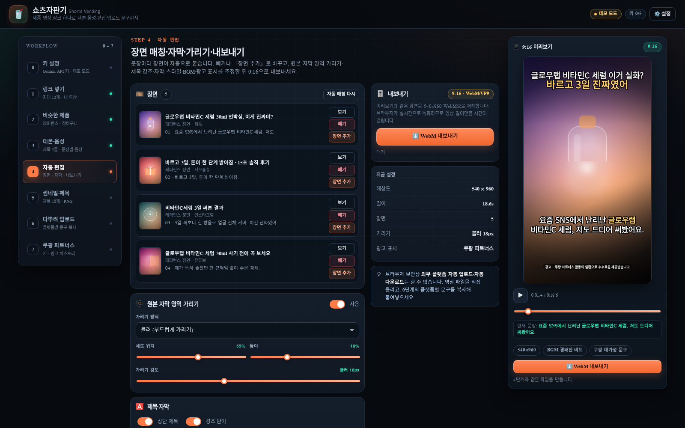

# 🥤 쇼츠자판기 (Shorts Vending)

제품 영상 링크를 넣으면 **대본 · AI 음성 · 자동 편집 · 썸네일 · 업로드 문구 · 쿠팡 링크**까지 한 번에 뽑아 주는 **단일 HTML 정적 웹앱**입니다.
서버가 없고, 설치가 없고, API 키는 사용자의 브라우저(localStorage)에만 저장됩니다.

- 파일: `index.html` 하나 (CSS·JS·아이콘 전부 인라인, **외부 CDN/폰트 요청 0건**)
- 화면: 데스크톱 3열(단계 / 작업 / 9:16 미리보기), 모바일 390px 단일 열 + 하단 내비
- 테마: 다크 자판기 (오렌지·민트 포인트), 한국어 UI



---

## 0. 바로 실행

```bash
# 아무 정적 서버로 열면 됩니다 (권장)
cd shorts-vending-webapp
python3 -m http.server 8000
# → http://localhost:8000/index.html
```

`index.html`을 더블클릭해도 대부분 동작하지만, **Gemini API 호출은 `file://`에서 CORS로 막힐 수 있어** 웹서버(또는 GitHub Pages·Netlify 같은 정적 호스팅) 사용을 권장합니다.
안드로이드의 기본 HTML 뷰어는 자바스크립트를 막아 버튼이 동작하지 않습니다 — **Chrome/Samsung Internet**으로 열어 주세요.

---

## 1. 0~7단계 구성

| 단계 | 이름 | 하는 일 |
|---|---|---|
| 0 | ⚙️ 키 설정 | Gemini API 키 **최대 5개** 저장·상태 표시(활성/대기/한도초과)·**429 자동 전환**·키 연결 테스트·데모 모드 |
| 1 | 링크 넣기 | 제품 영상 링크 **최대 12줄**, 내 영상 **MP4/WebM 다중 업로드**, 첫 항목 **대표 영상** 지정, 찾을 플랫폼 선택, `분석 시작` |
| 2 | 비슷한 제품 | AI 제품 정보(이름·카테고리·가격·후킹·키워드) + **레퍼런스 6장**(조회수·좋아요·특징) + 장바구니 담기/빼기 → `다음: 대본 쓰기` |
| 3 | 대본·음성 | 언어 4종(한/영/일/중)·톤 3종·길이 3종 → **상단 제목 2줄·강조 단어·문장별 대본**(직접 수정) → 목소리·속도 → **문장별 시간표 음성** |
| 4 | 자동 편집 | 문장별 **장면 자동 매칭**(빼기 / 장면 추가 교체), **원본 자막 영역 가리기(블러·모자이크)**, 제목 2줄·강조·자막 크기/위치/글꼴/색, BGM, **(광고)·쿠팡 대가성 문구**, `다음 영상에도 이 설정으로` 저장, **9:16 실시간 미리보기 + WebM 내보내기** |
| 5 | 썸네일·제목 | `제목·설명 추천받기` → **제목 10개**, 선택 시 설명·해시태그·썸네일 문구 자동, **1080×1920 PNG 다운로드** |
| 6 | 다뿌려 업로드 | YouTube Shorts·TikTok·Instagram Reels·Threads·Facebook Reels **문구 자동 생성·원클릭 복사·업로드 페이지 열기**, `마지막 「게시」 버튼은 내가 직접 누르기` 체크 |
| 7 | 쿠팡 파트너스 | Access/Secret Key **로컬 저장(서버 전송 X)**, **개인 링크 히스토리 표**, 링크가 비면 **상품명으로 자동 생성**, **대가성 문구 자동 추가** |

각 단계는 왼쪽 레일(모바일은 상단 가로 스크롤)로 언제든 오갈 수 있고, 완료한 단계에는 초록 점이 붙습니다.

---

## 2. Gemini 키 넣기 (처음 한 번)

1. <https://aistudio.google.com/apikey> → Google 로그인 → **API 키 만들기** (카드 등록 없음)
2. 앱의 **⚙️ 설정** → 키 칸에 붙여넣기 → **저장** (최대 5개, 계정마다 하나씩)
3. 한도가 찬 키(HTTP 429/401/403)는 **자동으로 ‘한도초과’로 표시되고 다음 키로 전환**됩니다. 이미 소진된 키는 다시 호출하지 않습니다.
4. 무료 키는 하루 영상 2편 정도. 많이 만들면 유료 키(영상 1편당 약 10~100원)를 권장합니다.
5. 실패 응답 처리: **429·401·403**, 그리고 **400 RESOURCE_EXHAUSTED**(한도)도 ‘한도초과’로 보고 다음 키로 넘어갑니다. 텍스트 모델이 404면 `gemini-2.0-flash`로 한 번 더 시도합니다.

**데모 모드**가 켜져 있거나 키가 없으면 API를 호출하지 않고,
- 분석·대본·제목: 내장 카탈로그·규칙 기반 샘플
- 음성: 브라우저 **Web Audio 포만트 합성음**(실제 사람 목소리 아님, 길이는 실제 생성된 오디오에서 측정)
- 편집·미리보기·WebM 내보내기·썸네일·문구: **전부 실제 동작**

로 전체 흐름을 체험할 수 있습니다.

---

## 3. 데이터·보안

| 항목 | 처리 |
|---|---|
| Gemini 키 | `localStorage`(`sv.keys.v1`)에만 저장. 서버 전송 없음. 브라우저에서 Google API로 직접 호출 |
| 쿠팡 Access/Secret | `localStorage`(`sv.coupang.v1`)에만 저장. 어떤 요청에도 실리지 않음 |
| 편집 프리셋 | `localStorage`(`sv.preset.v1`) — `다음 영상에도 이 설정으로` |
| 링크 히스토리 | `localStorage`(`sv.hist.v1`) — 내보내기/수동 추가 시 자동 기록 |
| 영상 파일 | 브라우저 메모리(`blob:` URL)에서만 처리, 업로드/전송 없음 |
| 외부 요청 | **Gemini API 호출 외 0건** (CDN·폰트·분석 도구 없음) |

브라우저 데이터를 지우면 키·프리셋·히스토리도 함께 사라집니다. 공용 PC에서는 **⚙️ 설정 → 키 삭제**, **7단계 → 키 삭제**를 사용하세요.

---

## 4. 꼭 알아 둘 제한 (사실 그대로)

- **자동 업로드·자동 다운로드는 지원하지 않습니다.** 브라우저 보안상 다른 플랫폼에 로그인 상태로 파일을 올리거나 영상을 대신 내려받게 할 수 없습니다. 이 앱은 ① 4단계에서 만든 **WebM 파일 직접 업로드** ② **플랫폼별 문구 복사** ③ **업로드 페이지 열기**까지만 합니다. 마지막 「게시」는 직접 누르세요.
- **쿠팡 파트너스 API 실호출은 브라우저에서 불가**합니다(HMAC 서명 + CORS). 이 앱은 키 보관 · 링크 히스토리 · 문구 자동화까지 담당하며, **자동 생성 링크는 임시 링크**입니다. 실제 파트너스 링크로 교체하세요.
- **실제 Gemini API 호출은 이 제작 환경에 키가 없어 미검증**입니다. 대신 자동 테스트에서 ① 429 자동 전환 ② JSON 응답 파싱 ③ TTS PCM(24kHz) → 타임라인 변환을 **모의 서버로 검증**했습니다. 실제 키로 처음 호출할 때 모델명·응답 형식이 다르면 알려 주세요.
- **MP4 디코딩은 브라우저 코덱에 따릅니다.** Chrome·Samsung Internet은 대부분 재생하지만, 일부 Chromium 빌드는 H.264를 지원하지 않습니다(테스트는 WebM으로 수행).
- **데모 음성은 합성음**입니다. 실제 Gemini 키가 있으면 `gemini-2.5-flash-preview-tts`를 사용합니다.
- **데모 분석·제목·조회수·좋아요는 규칙 기반 추정치**입니다. 실제 수치가 아닙니다.
- 폰트는 시스템 폰트(Noto Sans/Serif CJK, 맑은 고딕 등)를 사용합니다. 커스텀 폰트 파일은 포함하지 않았습니다.
- 키 없이도 WebM 내보내기는 되지만, **내보내기는 브라우저가 실시간으로 녹화**하므로 영상 길이만큼 시간이 걸립니다.

---

## 5. 빌드

```bash
cd shorts-vending-webapp
python3 build/build.py       # build/{body.html,style.css,app.js} → index.html
```

`build.py`는 인라인 후 `<script src>`, 외부 `href`, `@import`가 남아 있으면 실패합니다. 외부 의존성 없이 `index.html` 하나로 배포할 수 있습니다.

```
shorts-vending-webapp/
├── index.html               # 배포 파일 (단일 HTML)
├── build/
│   ├── body.html            # 화면 구조 (0~7단계·설정 모달·미리보기)
│   ├── style.css            # 다크 자판기 테마 · 반응형
│   ├── app.js               # 상태·Gemini·음성합성·캔버스 렌더러·내보내기
│   └── build.py             # 인라인 빌드 + 외부 참조 검사
├── preview-vending.png      # 4단계 화면 (데스크톱)
├── preview-vending-mobile.png  # 4단계 화면 (모바일 390px)
└── test/
    ├── run_tests.py         # 256개 자동 테스트
    ├── shots_suite.py       # 배포용 스크린샷 생성
    ├── last_run.log         # 최근 테스트 로그
    ├── media/               # 테스트용 3초/2.5초 WebM
    ├── shots/               # 단계별 스크린샷
    └── out/                 # 내보낸 WebM·PNG 산출물
```

---

## 6. 테스트

```bash
python3 test/run_tests.py
```

Playwright(headless Chromium)로 **0~7단계 전체 플로우**를 실제 클릭으로 검증합니다.

- 0단계: 키 5개 한도, 상태 라벨, **429 3개 연속 → 4번 키 자동 전환**, 소진 키 재시도 금지, 전부 소진 시 데모 폴백, **한도 상태 초기화**
- 1~2단계: 12줄 제한, 잘못된 줄 무시, 대표 영상 지정, WebM 2개 업로드·메타데이터·포스터, 데모 분석, 레퍼런스 6장, 장바구니
- 3단계: 4개 언어, 톤·길이(3/5/7문장), 제목 2줄·강조·문장 편집, **합성음 실측 타임라인**, 속도 변화
- 4단계: 장면 빼기/교체, 블러·모자이크, 자막 크기·위치·글꼴·색, 제목, BGM, (광고)/쿠팡 문구, 프리셋 저장
- 미리보기: 9:16 비율, 재생·탐색, 문장 동기화
- **WebM 내보내기: 540×960 · 길이 일치 · 오디오 디코드(RMS>0) · 프레임 비어 있지 않음 · 다운로드**
- 5단계: 제목 10개, 설명/해시태그/썸네일 문구, **PNG 1080×1920 · 다운로드**
- 6단계: 5개 플랫폼 문구·복사·업로드 링크·게시 확인 체크
- 7단계: 키 로컬 저장(요청에 시크릿 없음), 자동 링크, 히스토리 추가/복사/삭제, 대가성 문구 토글
- 레이아웃: **390×844 전 단계 가로 오버플로 0**, 1440 3열, 1024 1열, 터치 타깃
- **콘솔 오류 0, JS 예외 0, Gemini 외 외부 요청 0**
- 새로고침 후 키·프리셋·쿠팡·히스토리 유지

최근 결과: **256/256 통과** (`test/last_run.log`).
